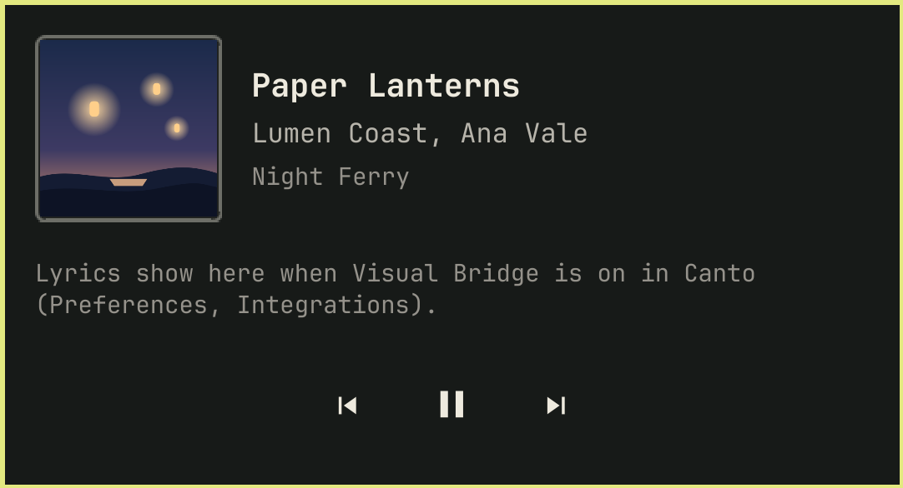

# Canto Now Playing for Omarchy

**English** · [Português (Brasil)](README.pt-BR.md)

What [Canto](https://github.com/gusthanks/canto) is playing, in the [Omarchy](https://omarchy.org)
bar: the title and artist, or the line of the song being sung right now. Click to play or
pause, scroll to skip, right-click for a small popup with the cover.

<p align="center"></p>
<p align="center"></p>

## What you get

- **A quiet pill**: a music note and *Title · Artist*, cut with an ellipsis past the width
  you choose. Dimmed while paused, hidden while Canto is closed or has nothing loaded.
- **The lyric line, live**: with Canto's Visual Bridge on, the pill shows the synced line
  being sung, in italic so it never reads as a title. Each new line cross-fades in. While
  a song has lyrics the pill keeps one width, so the rest of your bar does not shift with
  every line; between verses it falls back to the title.
- **Controls where your hand is**: the same mouse map as Omarchy's own media widget (see
  [Use](#use)). Scrolling on a touchpad skips one track per swipe, not a whole album.
- **A small popup**: the cover, title, artists and album, the current lyric line, and
  previous / play-pause / next. Click the cover to bring Canto's window up.
- **Only Canto**: other players (browsers, video) never show up here. Omarchy's media
  widget still covers those.
- **Your theme and language**: colors, font and corner radius come from Omarchy's theme;
  strings follow the language picked in Omarchy's setup (English and Brazilian Portuguese).

<p align="center">
  
  
</p>

*(Screenshots are rendered from mock data by the dev harness, see [Development](#development).
The track, lyric and cover are made up.)*

## Lyrics need Visual Bridge

Title, artist, cover and controls work as soon as Canto runs. The lyric line needs one
switch in Canto, off by default:

**Canto: Preferences, Integrations, Visual Bridge, turn on "Enable Visual Bridge".**

Canto then writes what is playing, with the current synced line, to
`$XDG_RUNTIME_DIR/canto/state.json`, and this widget reads it. Songs without synced lyrics
simply show the title. If you never want lyrics in the bar, turn the `showLyric` setting off
(this also hides the hint in the popup).

## Install

```bash
omarchy plugin add https://github.com/gusthanks/omarchy-canto.git --enable
omarchy restart shell
```

It lands just right of the bar's center group (next to the clock in the default layout). Move it with `omarchy bar move`, for
example `omarchy bar move gusthx.canto --section right --index 0`.

Update with `omarchy plugin update gusthx.canto --yes`, then `omarchy restart shell`.

## Use

| On the pill | Does |
|---|---|
| Left click | Play / pause |
| Middle click | Next track |
| Right click | Open or close the popup |
| Scroll up / down | Previous / next track |
| Hover | Tooltip with the title and artist (handy while the pill shows a lyric) |

## Configuration

Two settings, in the bar's settings form or from a terminal:

```bash
omarchy bar set gusthx.canto showLyric false --json   # always show Title · Artist
omarchy bar set gusthx.canto maxWidth 320 --json      # wider pill (120 to 600, default 240)
```

`maxWidth` is in pixels before your display scaling.

Motion follows Hyprland: with animations turned off there (`animations:enabled = false`),
the lyric changes without the fade.

## Privacy

No account, no telemetry, no logs.

What it **reads**: Canto's MPRIS player on the session D-Bus (track, artists, album, cover
link, playing state), and, only while the lyric is shown or the popup is open,
`$XDG_RUNTIME_DIR/canto/state.json`. It writes nothing.

What it **contacts**: nothing on its own. While the popup is open it shows the cover from
the link Canto reports, which for Spotify tracks is Spotify's image server.

## Development

Work in a clone of this repository, never in the installed copy under
`~/.config/omarchy/plugins/` (saving there hot-reloads your bar). `dev/run.sh` starts a
**separate** Quickshell instance with Omarchy's `Commons`/`Ui` libraries, this repo and
mock data from `dev/mock/`: it never touches the running shell, D-Bus or the real bridge
file, and Canto does not need to run. Captures render offscreen, so nothing shows on screen.

```bash
dev/run.sh check     # compile every QML type, BarWidget.qml included
dev/run.sh test      # Model.js and i18n catalog tests (node --test, no npm packages)
dev/run.sh docs      # docs/bar.png, bar-lyric.png, panel.png, panel-hint.png
dev/run.sh preview   # both pills and the popup in a window
LANGUAGE=pt-BR dev/run.sh panel-hint   # docs/panel-hint-pt-BR.png
omarchy plugin validate .
```

Layout: `BarWidget.qml` (the bar slot: settings, mouse, popup window), `CantoSource.qml`
(Canto's MPRIS player and the actions), `Bridge.qml` (reads the Visual Bridge file),
`Pill.qml` (the pill), `NowPlayingView.qml` (the popup's content), `FadeText.qml` (the
cross-fading text), `Model.js` (pure helpers), `i18n/*.json` (strings, read through
`Commons.Translations`), `dev/` (harness, mocks, tests, deploy).

When everything is committed and tested, install it into your own bar once:

```bash
dev/deploy.sh   # validates, compiles, installs HEAD into the live plugin, restarts the shell once
```

See [AGENTS.md](AGENTS.md) for the rules AI agents (and humans) follow here.

## Changes

See [CHANGELOG.md](CHANGELOG.md).

## License

MIT. See [LICENSE](LICENSE). Copyright (c) 2026 Gustavo Costa (gusthx).
