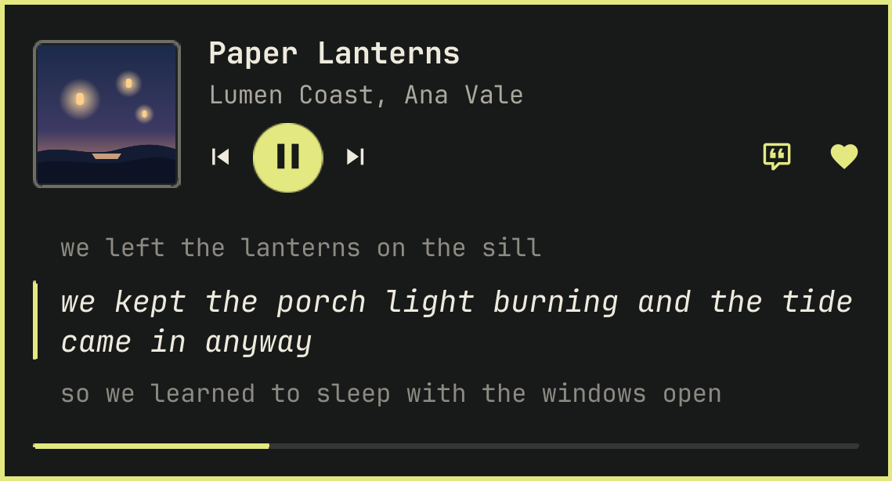
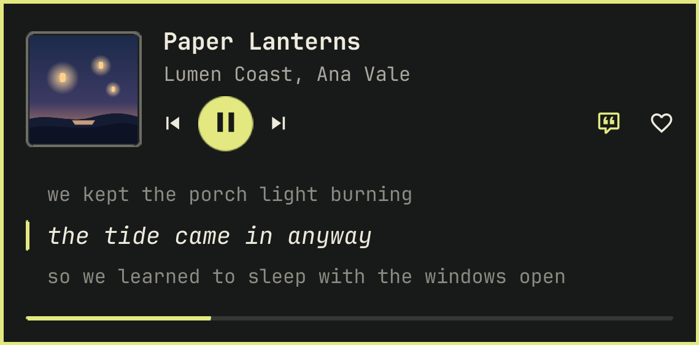

# Canto Now Playing for Omarchy

**English** · [Português (Brasil)](README.pt-BR.md)

What [Canto](https://github.com/gusthanks/canto) is playing, in the [Omarchy](https://omarchy.org)
bar: Canto's icon, previous / play-pause / next, then the title and artist, or the line of
the song being sung right now. Click the text to switch between the two. Right-click for a
popup laid out like Canto's mini player, with the lyric around the current line and a like
button.

<p align="center"></p>
<p align="center"></p>

## What you get

- **Canto's icon first**: click it to bring Canto's window up. With Canto closed the pill
  shrinks to the icon, dimmed, and a click starts Canto (or hide it until Canto runs).
- **Controls and the track**: small previous / play-pause / next buttons, then a music note
  and *Title · Artist* (cut with an ellipsis past the width you choose). Dimmed while
  paused. The buttons can be turned off, and a like button (a heart) can be turned on.
- **Click the text for the lyric**: the text switches to the synced line being sung, in
  italic and with Canto's lyrics icon in front, so it never reads as a title. Click again for the
  title. The choice is saved and survives a restart.
- **Never cut**: a line wider than the pill is shown in pages that break between words,
  page 1, then page 2, timed to finish before the next line starts. A new line always
  starts at page 1. No scrolling text, no animation running all the time.
- **Never confusing**: with no line to show (Visual Bridge off, an instrumental break, a song
  without synced lyrics) lyric mode shows the title with the lyrics icon dimmed. Hover the
  text for the track, what a click does, and, if needed, where to turn lyrics on.
- **A popup like Canto's mini player**: the cover, title and artist, previous / play / next
  with the play button as an accent circle, a lyrics toggle and the heart on the right, and
  a thin progress line along the bottom. With the lyrics toggle on (it is remembered), the
  line before, the current line (larger) and the next one, whole and wrapped. Click the
  cover or the title to bring Canto's window up.
- **Like from the bar**: the heart saves the track to your Liked Songs, or removes it. It
  fills at once and follows what Canto reports. It hides when Canto cannot say (an older
  Canto, or a track that is not on Spotify).
- **Only Canto**: other players (browsers, video) never show up here. Omarchy's media
  widget still covers those.
- **Your theme and language**: colors, font and corner radius come from Omarchy's theme;
  strings follow the language picked in Omarchy's setup (English and Brazilian Portuguese).

<p align="center">
  
  
</p>

<p align="center">
  
  
</p>
<p align="center">
  
  
</p>

*(Screenshots are rendered from mock data by the dev harness, see [Development](#development).
The track, lyric and cover are made up.)*

## Lyrics need Visual Bridge

Title, artist, cover and controls work as soon as Canto runs. The lyric line, the heart and
the popup's progress line (when MPRIS has no position) need one switch in Canto, off by
default:

**Canto: Preferences, Integrations, Visual Bridge, turn on "Enable Visual Bridge".**

Canto then writes what is playing, with the current synced line, to
`$XDG_RUNTIME_DIR/canto/state.json`, and this widget reads it. Songs without synced lyrics
simply show the title.

Recent Canto builds also send the lines before and after the current one, when the next
line starts, and whether the track is liked: the popup then shows the next line, long lines
page exactly in time, and the heart appears. With an older Canto the popup shows the line
before and the current one, pages last 1.6 s each (or follow the length of the previous
line), and there is no heart.

## Install

```bash
omarchy plugin add https://github.com/gusthanks/omarchy-canto.git --enable
omarchy restart shell
```

It lands in the bar's left section, after the workspaces. Move it with `omarchy bar move`,
for example `omarchy bar move gusthx.canto --section right --index 0`.

Update with `omarchy plugin update gusthx.canto --yes`, then `omarchy restart shell`.

## Use

| On the pill | Does |
|---|---|
| Canto icon | Bring Canto's window up, or start Canto when it is closed |
| Previous / play-pause / next buttons | What they say |
| Heart (if turned on) | Like or unlike the track |
| Click the text | Switch between the title and the lyric line (saved) |
| Middle click | Next track |
| Right click | Open or close the popup |
| Scroll up / down | Previous / next track (one per touchpad swipe) |
| Hover the text | The track, what a click does, and where to turn lyrics on if needed |

## Configuration

Settings, in the bar's settings form or from a terminal:

```bash
omarchy bar set gusthx.canto showControls false --json    # no previous / play / next in the bar
omarchy bar set gusthx.canto showLike true --json         # a heart in the bar too (always in the popup)
omarchy bar set gusthx.canto showWhenClosed false --json  # hide the widget while Canto is closed
omarchy bar set gusthx.canto startMode lyric              # start on the lyric line (title is the default)
omarchy bar set gusthx.canto popupLyrics false --json     # no lyric lines in the popup
omarchy bar set gusthx.canto maxWidth 320 --json          # wider text (120 to 600, default 240)
```

Clicking the text in the bar changes `startMode` for you, and the popup's lyrics button
changes `popupLyrics`. `maxWidth` is in pixels before
your display scaling: a longer lyric line pages, a longer title gets an ellipsis.

Motion follows Hyprland: with animations turned off there (`animations:enabled = false`),
the lyric changes without the fade.

## Privacy

No account, no telemetry, no logs.

What it **reads**: Canto's MPRIS player on the session D-Bus (track, artists, album, cover
link, playing state, position), and, only while lyric mode is on, the heart is in the bar or
the popup is open, `$XDG_RUNTIME_DIR/canto/state.json`. It **writes** only its own
`startMode` and `popupLyrics` settings to `~/.config/omarchy/shell.json`, when you click the
text or the popup's lyrics button, through the shell (as Omarchy's clock saves its format).

What it **runs**: `busctl --user call ... ToggleLiked` when you click the heart (Canto's own
D-Bus method), and `gtk-launch io.github.gusthanks.Canto` (or `canto`) when you start Canto
from the icon.

What it **contacts**: nothing on its own. While the popup is open it shows the cover from
the link Canto reports, which for Spotify tracks is Spotify's image server.

## Development

Work in a clone of this repository, never in the installed copy under
`~/.config/omarchy/plugins/` (saving there hot-reloads your bar). `dev/run.sh` starts a
**separate** Quickshell instance with Omarchy's `Commons`/`Ui` libraries, this repo and
mock data from `dev/mock/`: it never touches the running shell, D-Bus or the real bridge
file, and Canto does not need to run. Captures render offscreen, so nothing shows on screen.

```bash
dev/run.sh check     # compile every QML type, BarWidget.qml included
dev/run.sh test      # Model.js and i18n catalog tests (node --test, no npm packages)
dev/run.sh docs      # docs/bar.png, bar-closed.png, bar-lyric.png, bar-lyric-page1.png,
                     # bar-lyric-page2.png, panel.png, panel-unliked.png, panel-hint.png
dev/run.sh preview   # the pills and the popup in a window
LANGUAGE=pt-BR dev/run.sh panel-hint   # docs/panel-hint-pt-BR.png
omarchy plugin validate .
```

Layout: `BarWidget.qml` (the bar slot: settings, mode toggle, wheel, popup window),
`CantoSource.qml` (Canto's MPRIS player, liked, progress and the actions), `CantoIcon.qml`
(Canto's colorful app icon from `assets/`), `Bridge.qml` (reads the Visual
Bridge file: the lyric, the lines around it, timing), `Pill.qml` (buttons, text, paging), `NowPlayingView.qml` (the popup's content), `FadeText.qml` (the
cross-fading text), `Model.js` (pure helpers), `i18n/*.json` (strings, read through
`Commons.Translations`), `dev/` (harness, mocks, tests, deploy).

When everything is committed and tested, install it into your own bar once:

```bash
dev/deploy.sh   # validates, compiles, installs HEAD into the live plugin, restarts the shell once
```

See [AGENTS.md](AGENTS.md) for the rules AI agents (and humans) follow here.

## Changes

See [CHANGELOG.md](CHANGELOG.md).

## License

MIT. See [LICENSE](LICENSE). Copyright (c) 2026 Gustavo Costa (gusthx). The Canto icon in
`assets/` comes from [Canto](https://github.com/gusthanks/canto) (MIT, same author).
