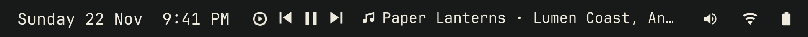
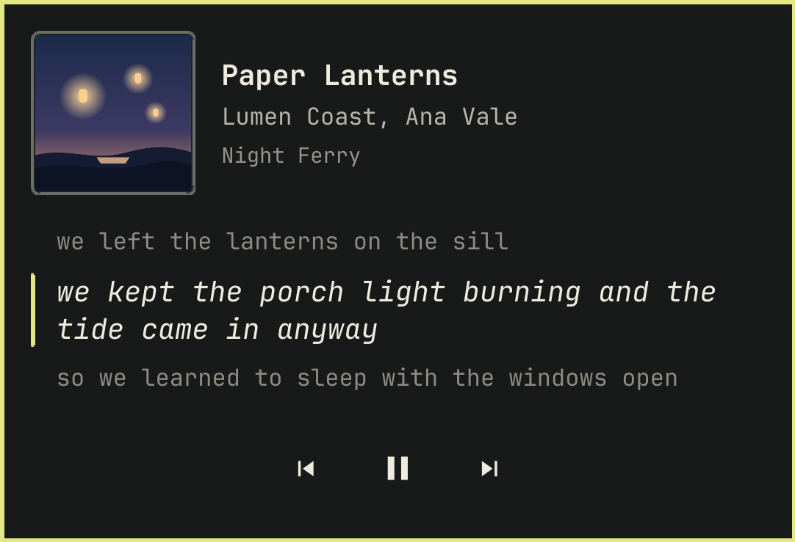
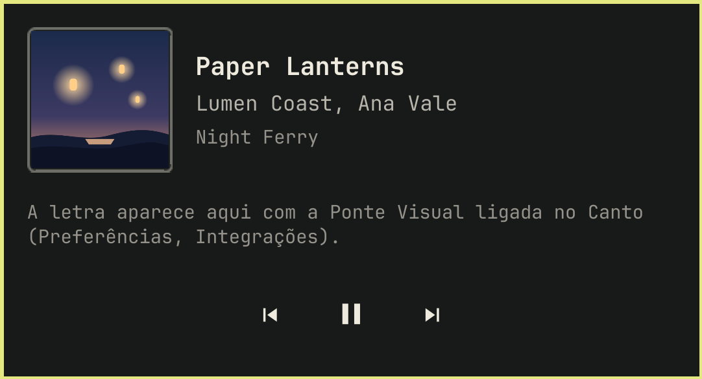

# Canto Now Playing para o Omarchy

[English](README.md) · **Português (Brasil)**

O que o [Canto](https://github.com/gusthanks/canto) está tocando, na barra do
[Omarchy](https://omarchy.org): o título e o artista, ou a linha da música que está sendo
cantada agora. Clique para tocar ou pausar, role para pular, clique com o botão direito para
abrir um popup pequeno com a capa.

<p align="center"></p>
<p align="center"></p>

## O que vem

- **Uma pílula discreta**: uma nota musical e *Título · Artista*, cortado com reticências
  depois da largura que você escolher. Fica apagada com a música pausada e some quando o
  Canto está fechado ou sem nada carregado.
- **A letra, ao vivo**: com a Ponte Visual (Visual Bridge) do Canto ligada, a pílula mostra
  a linha sincronizada que está sendo cantada, em itálico para nunca parecer um título. Cada
  linha nova entra com um fade. Enquanto a música tem letra, a pílula mantém a mesma largura,
  então o resto da barra não pula a cada linha; entre as estrofes volta para o título.
- **Controles onde a mão já está**: os mesmos cliques do widget de mídia do próprio Omarchy
  (veja [Uso](#uso)). No touchpad, cada deslizada pula uma faixa, não o álbum inteiro.
- **Um popup pequeno**: capa, título, artistas e álbum, a linha atual da letra e
  anterior / tocar-pausar / próxima. Clique na capa para trazer a janela do Canto.
- **Só o Canto**: outros players (navegador, vídeo) não aparecem aqui. O widget de mídia do
  Omarchy continua cuidando deles.
- **Seu tema e seu idioma**: cores, fonte e cantos vêm do tema do Omarchy; os textos seguem o
  idioma escolhido no setup do Omarchy (inglês e português do Brasil).

<p align="center">
  
  
</p>

*(As imagens são geradas com dados de teste pelo ambiente de desenvolvimento, veja
[Desenvolvimento](#desenvolvimento). A música, a letra e a capa são inventadas.)*

## A letra precisa da Ponte Visual

Título, artista, capa e controles funcionam assim que o Canto abre. A linha da letra precisa
de uma chave no Canto, que vem desligada:

**Canto: Preferências, Integrações, Ponte Visual, ligue "Ativar Ponte Visual".**
(Em inglês: Preferences, Integrations, Visual Bridge, "Enable Visual Bridge".)

Aí o Canto passa a escrever o que está tocando, com a linha sincronizada atual, em
`$XDG_RUNTIME_DIR/canto/state.json`, e este widget lê esse arquivo. Música sem letra
sincronizada mostra só o título. Se você nunca quiser letra na barra, desligue a opção
`showLyric` (isso também esconde o aviso no popup).

## Instalar

```bash
omarchy plugin add https://github.com/gusthanks/omarchy-canto.git --enable
omarchy restart shell
```

Ele entra logo à direita do grupo central da barra (ao lado do relógio, no layout padrão).
Para mudar de lugar, use `omarchy bar move`, por exemplo
`omarchy bar move gusthx.canto --section right --index 0`.

Para atualizar: `omarchy plugin update gusthx.canto --yes` e depois `omarchy restart shell`.

## Uso

| Na pílula | Faz |
|---|---|
| Clique esquerdo | Tocar / pausar |
| Clique do meio | Próxima faixa |
| Clique direito | Abre ou fecha o popup |
| Rolar para cima / para baixo | Faixa anterior / próxima |
| Passar o mouse | Dica com título e artista (útil enquanto a pílula mostra a letra) |

## Configuração

Duas opções, no formulário de configurações da barra ou pelo terminal:

```bash
omarchy bar set gusthx.canto showLyric false --json   # sempre mostrar Título · Artista
omarchy bar set gusthx.canto maxWidth 320 --json      # pílula mais larga (120 a 600, padrão 240)
```

`maxWidth` é em pixels antes da escala da tela.

O movimento segue o Hyprland: com as animações desligadas lá (`animations:enabled = false`),
a letra troca sem o fade.

## Privacidade

Sem conta, sem telemetria, sem log.

O que ele **lê**: o player MPRIS do Canto no D-Bus da sessão (faixa, artistas, álbum, link da
capa, se está tocando) e, só enquanto a letra aparece ou o popup está aberto,
`$XDG_RUNTIME_DIR/canto/state.json`. Ele não escreve nada.

O que ele **acessa**: nada por conta própria. Com o popup aberto, ele mostra a capa a partir
do link que o Canto informa, que nas faixas do Spotify é o servidor de imagens do Spotify.

## Desenvolvimento

Trabalhe num clone deste repositório, nunca na cópia instalada em
`~/.config/omarchy/plugins/` (salvar lá recarrega a sua barra). `dev/run.sh` abre uma
instância **separada** do Quickshell com as bibliotecas `Commons`/`Ui` do Omarchy, este
repositório e os dados de teste de `dev/mock/`: não mexe no shell em uso, no D-Bus nem no
arquivo real da Ponte Visual, e o Canto não precisa estar aberto. As capturas são feitas fora
da tela, então nada aparece no monitor.

```bash
dev/run.sh check     # compila todos os tipos QML, BarWidget.qml incluído
dev/run.sh test      # testes do Model.js e dos catálogos de texto (node --test, sem npm)
dev/run.sh docs      # docs/bar.png, bar-lyric.png, panel.png, panel-hint.png
dev/run.sh preview   # as duas pílulas e o popup numa janela
LANGUAGE=pt-BR dev/run.sh panel-hint   # docs/panel-hint-pt-BR.png
omarchy plugin validate .
```

Quando tudo estiver commitado e testado, instale na sua barra uma vez só:

```bash
dev/deploy.sh   # valida, compila, instala o HEAD no plugin em uso e reinicia o shell uma vez
```

As regras para agentes de IA (e pessoas) estão em [AGENTS.md](AGENTS.md).

## Mudanças

Veja o [CHANGELOG.md](CHANGELOG.md).

## Licença

MIT. Veja [LICENSE](LICENSE). Copyright (c) 2026 Gustavo Costa (gusthx).
