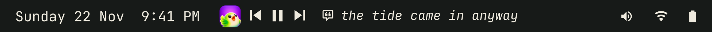

# Canto Now Playing para o Omarchy

[English](README.md) · **Português (Brasil)**

O que o [Canto](https://github.com/gusthanks/canto) está tocando, na barra do
[Omarchy](https://omarchy.org): anterior / tocar-pausar / próxima, depois o título e o
artista, ou a linha da música que está sendo cantada agora. Clique no texto para alternar
entre os dois. Clique com o botão direito para abrir um popup pequeno com a capa e a letra em
volta da linha atual.

<p align="center"></p>
<p align="center"></p>

## O que vem

- **Controles e a faixa**: botões pequenos de anterior / tocar-pausar / próxima, depois uma
  nota musical e *Título · Artista* (cortado com reticências depois da largura que você
  escolher). Fica apagado com a música pausada e some quando o Canto está fechado ou sem nada
  carregado. Os botões podem ser desligados.
- **Clique no texto para ver a letra**: o texto troca para a linha sincronizada que está sendo
  cantada, em itálico e com um microfone na frente, para nunca parecer um título. Clique de
  novo para voltar ao título. A escolha fica salva e sobrevive a um reinício.
- **Nunca cortado**: uma linha mais larga que a pílula aparece em páginas que quebram entre as
  palavras, página 1, depois página 2, no tempo certo para terminar antes da próxima linha.
  Linha nova sempre começa na página 1. Sem texto rolando, sem animação rodando o tempo todo.
- **Nunca confuso**: sem linha para mostrar (Ponte Visual desligada, parte instrumental, música
  sem letra sincronizada), o modo letra mostra o título com o microfone apagado. Passe o mouse
  no texto para ver a faixa, o que o clique faz e, se precisar, onde ligar a letra.
- **Um popup pequeno**: capa, título, artistas e álbum, a linha anterior, a atual (maior) e a
  próxima, inteiras e quebradas em linhas, e anterior / tocar-pausar / próxima. Clique na capa
  para trazer a janela do Canto.
- **Só o Canto**: outros players (navegador, vídeo) não aparecem aqui. O widget de mídia do
  Omarchy continua cuidando deles.
- **Seu tema e seu idioma**: cores, fonte e cantos vêm do tema do Omarchy; os textos seguem o
  idioma escolhido no setup do Omarchy (inglês e português do Brasil).

<p align="center">
  
  
</p>

<p align="center">
  
  
</p>

*(As imagens são geradas com dados de teste pelo ambiente de desenvolvimento, veja
[Desenvolvimento](#desenvolvimento). A música, a letra e a capa são inventadas.)*

## A letra precisa da Ponte Visual

Título, artista, capa e controles funcionam assim que o Canto abre. A linha da letra precisa
de uma chave no Canto, que vem desligada:

**Canto: Preferências, Integrações, Ponte Visual, ligue "Ativar Ponte Visual".**
(Em inglês: Preferences, Integrations, Visual Bridge, "Enable Visual Bridge".)

Aí o Canto passa a escrever o que está tocando, com a linha sincronizada atual, em
`$XDG_RUNTIME_DIR/canto/state.json`, e este widget lê esse arquivo. Música sem letra
sincronizada mostra só o título.

As versões recentes do Canto também mandam a linha anterior, a próxima e quando a próxima
começa: aí o popup mostra a próxima linha e as linhas longas trocam de página no tempo exato.
Com um Canto mais antigo, o popup mostra a linha anterior e a atual, e cada página fica 1,6 s
(ou segue a duração da linha anterior).

## Instalar

```bash
omarchy plugin add https://github.com/gusthanks/omarchy-canto.git --enable
omarchy restart shell
```

Ele entra logo à direita do grupo central da barra (ao lado do relógio, no layout padrão).
Para mudar de lugar, use `omarchy bar move`, por exemplo
`omarchy bar move gusthx.canto --section right --index 0`.

Para atualizar: `omarchy plugin update gusthx.canto --yes` e depois `omarchy restart shell`.

## Uso

| Na pílula | Faz |
|---|---|
| Botões anterior / tocar-pausar / próxima | O que dizem |
| Clique no texto | Alterna entre o título e a letra (fica salvo) |
| Clique do meio | Próxima faixa |
| Clique direito | Abre ou fecha o popup |
| Rolar para cima / para baixo | Faixa anterior / próxima (uma por deslizada no touchpad) |
| Passar o mouse no texto | A faixa, o que o clique faz e onde ligar a letra, se precisar |

## Configuração

Três opções, no formulário de configurações da barra ou pelo terminal:

```bash
omarchy bar set gusthx.canto showControls false --json  # só o texto, sem botões
omarchy bar set gusthx.canto startMode lyric            # começar na letra (o padrão é o título)
omarchy bar set gusthx.canto maxWidth 320 --json        # texto mais largo (120 a 600, padrão 240)
```

Clicar no texto na barra muda o `startMode` para você. `maxWidth` é em pixels antes da escala
da tela: uma linha da letra mais longa vira páginas, um título mais longo ganha reticências.

O movimento segue o Hyprland: com as animações desligadas lá (`animations:enabled = false`),
a letra troca sem o fade.

## Privacidade

Sem conta, sem telemetria, sem log.

O que ele **lê**: o player MPRIS do Canto no D-Bus da sessão (faixa, artistas, álbum, link da
capa, se está tocando) e, só com o modo letra ligado ou o popup aberto,
`$XDG_RUNTIME_DIR/canto/state.json`. Ele **escreve** só a própria opção `startMode` em
`~/.config/omarchy/shell.json`, quando você clica no texto, pelo próprio shell (como o relógio
do Omarchy salva o formato).

O que ele **acessa**: nada por conta própria. Com o popup aberto, ele mostra a capa a partir
do link que o Canto informa, que nas faixas do Spotify é o servidor de imagens do Spotify.

## Desenvolvimento

Trabalhe num clone deste repositório, nunca na cópia instalada em
`~/.config/omarchy/plugins/` (salvar lá recarrega a sua barra). `dev/run.sh` abre uma
instância **separada** do Quickshell com as bibliotecas `Commons`/`Ui` do Omarchy, este
repositório e os dados de teste de `dev/mock/`: não mexe no shell em uso, no D-Bus nem no
arquivo real da Ponte Visual, e o Canto não precisa estar aberto. As capturas são feitas fora
da tela, então nada aparece no monitor.

```bash
dev/run.sh check     # compila todos os tipos QML, BarWidget.qml incluído
dev/run.sh test      # testes do Model.js e dos catálogos de texto (node --test, sem npm)
dev/run.sh docs      # docs/bar.png, bar-lyric.png, bar-lyric-page1.png, bar-lyric-page2.png,
                     # panel.png, panel-hint.png
dev/run.sh preview   # as pílulas e o popup numa janela
LANGUAGE=pt-BR dev/run.sh panel-hint   # docs/panel-hint-pt-BR.png
omarchy plugin validate .
```

Quando tudo estiver commitado e testado, instale na sua barra uma vez só:

```bash
dev/deploy.sh   # valida, compila, instala o HEAD no plugin em uso e reinicia o shell uma vez
```

As regras para agentes de IA (e pessoas) estão em [AGENTS.md](AGENTS.md).

## Mudanças

Veja o [CHANGELOG.md](CHANGELOG.md).

## Licença

MIT. Veja [LICENSE](LICENSE). Copyright (c) 2026 Gustavo Costa (gusthx).
